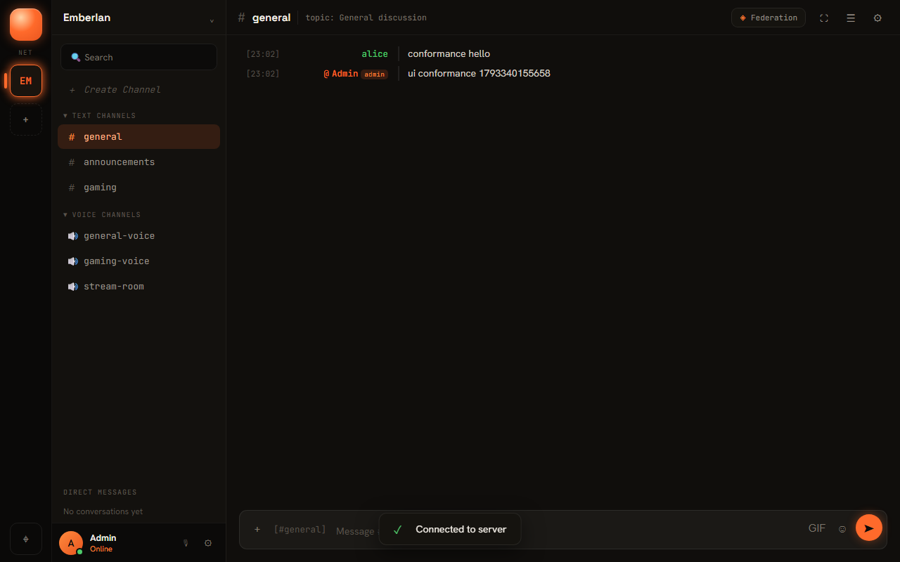

<p align="center">
  
</p>

# Emberlan

## What it is

Emberlan is a self-hosted chat server for gaming groups: text channels, end-to-end encrypted
direct messages, voice channels, media bots and server-to-server federation, run from your own
machine on Node.js and MongoDB. It fills the same role as Discord, but you host it and keep the data.

One UI (`client/public/`) is served to the browser by the server and shipped unchanged in the
Windows desktop app and the Android app.

Emberlan was formerly called **f7lans**, after the clan it was built for. The MongoDB database is
still named `f7lans` and the Docker volumes are still `f7lans-*` so existing installs keep their
data; `F7LANS_*` environment variables still work as fallbacks for `EMBERLAN_*`.

## Status

**Version 1.0.0, alpha.** Usable among friends; not ready for anything you depend on.

- Works today: accounts (local and Google sign-in), text channels, E2E encrypted DMs, voice
  channels with audio, camera video and screen share (WebRTC, peer to peer), admin settings,
  media bot configuration, federation setup.
- Voice is a full mesh: each user sends one copy to every other user, so it suits LAN-party sizes
  (around 8 people). It uses STUN only: it works on a LAN, over Tailscale and on most home
  networks, but users behind strict NAT need a TURN server (see [ROADMAP.md](ROADMAP.md)).
- Clients: web, Windows desktop (Electron), Android (Capacitor). macOS, Linux desktop and iOS
  are not supported.
- Downloads: a `v*` tag builds the Windows installer and an Android debug APK and attaches them to a
  GitHub Release (`.github/workflows/ci.yml`). No version has been tagged yet, so for now build from
  source (see below).

What comes next is in [ROADMAP.md](ROADMAP.md); changes are in [CHANGELOG.md](CHANGELOG.md).

## Screenshots

Captured from the running app by the conformance harness (`node conformance/run.js --screenshots`).




The images under `design_ref/design_handoff_ember/screenshots/` are design mockups, not captures.

## Getting Started

### Quick start (Windows, Docker)

1. Install [Docker Desktop](https://www.docker.com/products/docker-desktop) and start it.
2. Download this repository (green **Code** button, **Download ZIP**) and unzip it.
3. Double-click `scripts\quickstart.bat`.

The script checks that Docker is installed and running, runs `docker-compose up -d --build`
(MongoDB 7 plus the Emberlan server), waits ten seconds, checks `http://localhost:3001/health`,
and offers to open the browser. The first build takes a few minutes. If Docker is missing it stops
and tells you where to get it; it does not install anything for you.

4. Open <http://localhost:3001> and log in as `admin` / `admin123`.
5. **Change the admin password right away.** The Settings > Account "Change" button does not
   work yet (it only shows a toast), so use the API, as shown in step 6 of Step by step.

On Linux, `./scripts/docker-start.sh` does the same thing.

### Step by step (no Docker)

Prerequisites: Node.js 18 or newer (20 LTS recommended), npm, and MongoDB 6 or 7 running locally.

1. Get the code:
   ```bash
   git clone https://github.com/sp00nznet/emberlan.git emberlan
   cd emberlan
   ```
2. Install server dependencies:
   ```bash
   npm install
   ```
   On Windows, `scripts\setup.bat` runs this step, installs the desktop client's dependencies,
   creates `.env` and makes `server\uploads\avatars`. On Debian 12, `scripts/setup-debian.sh`
   also installs Node.js.
3. Create the config and set a real `JWT_SECRET` (the server falls back to a built-in default
   otherwise, which anyone can read in this repo):
   ```bash
   cp .env.example .env
   ```
   `MONGODB_URI` defaults to `mongodb://localhost:27017/f7lans`. All settings are in
   [docs/running.md](docs/running.md).
4. Start the server:
   ```bash
   npm start
   ```
   It prints a banner ending with `Server running on port 3001` and, on the first run,
   `Default admin created: admin / admin123`.
5. Check it:
   ```bash
   curl http://localhost:3001/health
   ```
   returns `{"status":"ok","name":"Emberlan Server","version":"1.0.0",...}`.
6. Open <http://localhost:3001> and log in as `admin` / `admin123`. Change the password through
   the API (the UI has no working password form yet):
   ```bash
   TOKEN=$(curl -s -H "Content-Type: application/json" -d '{"username":"admin","password":"admin123"}'      http://localhost:3001/api/auth/login | node -pe 'JSON.parse(require("fs").readFileSync(0)).token')
   curl -X PUT -H "Authorization: Bearer $TOKEN" -H "Content-Type: application/json"      -d '{"currentPassword":"admin123","newPassword":"something-long"}' http://localhost:3001/api/auth/password
   ```

Usual trip-ups: MongoDB not running (the server retries five times, five seconds apart, then
prints `All MongoDB connection attempts failed. Exiting.`); port 3001 already
in use (set `PORT` in `.env`); on Windows, a new terminal is needed after installing Node.js before
`npm` is on the PATH.

## Usage

- **Web:** browse to the server, e.g. `http://localhost:3001`.
- **Windows desktop:** run the built installer, enter the server address on the login screen.
  `npm run electron:embedded` (from the repo root) starts the desktop app with a server inside it;
  `npm run electron:headless` runs only the embedded server with a tray icon.
- **Android:** install the APK, enter the server address on the login screen.
- **Admin:** Settings has panels for channels, groups and roles, media bots, federation and
  server settings. Bots are covered in [docs/bots.md](docs/bots.md), federation in
  [docs/federation.md](docs/federation.md), Game Together in
  [docs/game-together.md](docs/game-together.md).
- **Backup:** `scripts\backup-database.bat` / `scripts\restore-database.bat` (see
  [docs/running.md](docs/running.md)).

More docs: [architecture](docs/architecture.md), [API](docs/api.md),
[features](docs/features.md), [development](docs/development.md),
[conformance](docs/conformance.md).

## Building from source

**Server:** no build step. `npm install && npm start`, or `docker-compose up -d --build`.

**Windows desktop** (on Windows):
```bash
cd electron-client
npm install
npm run build:win
```
This copies `client/public` into `electron-client/renderer/` and writes an NSIS installer and a
portable `.exe` to `electron-client/dist/`. `npm run build:win:unified` also bundles the server.

**Android** (Capacitor 7; needs JDK 21 and Android SDK 35):
```bash
cd mobile
npm install
npm run build:android
```
This builds `mobile/www/` from `client/public` plus `native-bridge.js`, syncs the committed
`mobile/android/` project and runs Gradle `assembleDebug`, producing
`mobile/android/app/build/outputs/apk/debug/app-debug.apk`. Cleartext HTTP is allowed so the app can
reach a plain-HTTP server on your LAN.

## Conformance

<!-- conformance -->**218/218** checks passing<!-- /conformance -->

```bash
npm install
node conformance/run.js            # full run, compares to conformance/results.json
node conformance/run.js --static   # contract checks only, no MongoDB
node conformance/run.js --accept   # write a new baseline, history row and this README line
node conformance/run.js --screenshots   # also write docs/screenshots/*.png
```

The contract corpus checks that every API call and socket event in the client has a server side,
and that the desktop and Android bridges expose the same functions. The live corpus boots the real
server against an in-memory MongoDB and drives login, chat, DMs and voice join. The UI corpus
drives the real UI in headless Chrome or Edge (set `CHROME_PATH` if it is not found). It exits 1
when a check that passed in the baseline fails, and runs in CI on every push and PR to `main`.
It includes two users in a voice call: audio both ways, camera on and off, deafen, leave. Details: [docs/conformance.md](docs/conformance.md).

## License

MIT. See [LICENSE](LICENSE). Vendored libraries in `client/public/vendor/` (socket.io-client,
hls.js, mpegts.js) keep their own licenses; see [NOTICE](NOTICE) and `LICENSES/`.
