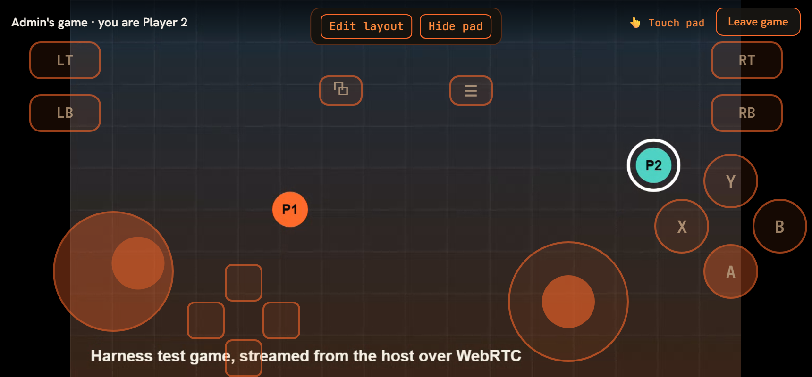

# Game Together

Play a local-multiplayer game with people in your voice channel. The host runs the game on
their Windows PC; up to three others join as Players 2–4 from the desktop app, a browser or the
Android app, with a controller or the on-screen touch pad. The game sees them as Xbox controllers
plugged into the host's PC, so any game that supports local multiplayer with Xbox pads works.



(The harness takes that screenshot: the "game" is a canvas test pattern streamed from the host tab,
and Player 2 moves with the guest's touches.)

## How it works

```
guest's pad or touch pad --(WebRTC data channel, peer to peer)--> host's desktop app --> ViGEmBus --> game
host's game window       --(WebRTC screen share)-----------------> guest's play view
```

- **Input never goes through the server.** Each guest sends their whole pad state about 60 times a
  second over an unordered, no-retransmit data channel on the voice call (`client/public/voice-rtc.js`).
  A lost message is replaced by the next one instead of delaying it. Unchanged state is resent every
  250 ms, so a lost "button released" can't leave a button held.
- **The server only hands out seats** (`server/services/gameTogetherService.js`): one session per
  voice channel, host = Player 1, guests get the lowest free slot 2–4. Leaving voice or
  disconnecting frees your seat; the host leaving ends the session.
- **The host's app drives virtual pads** (`electron-client/gamepads.js`): one virtual Xbox 360
  controller per guest slot via [ViGEmBus](https://github.com/nefarius/ViGEmBus). The host only
  accepts input from guests who hold a seat, and maps each guest to their own pad.
- **Guests get a play view** (`client/public/gametogether.js`): the host's screen share fills the
  screen, with a bar for the seat number, the input source and **Leave game**.

## Hosting (Windows)

1. Install the [ViGEmBus driver](https://github.com/nefarius/ViGEmBus/releases) once. Without it,
   **Host a game** says "ViGEmBus is not installed".
2. Use the Emberlan desktop app; browsers and phones can join but not host.
3. Join a voice channel, open **🎮 Play** in the voice panel, and choose **Host a game**. Pick the
   game window when asked to share your screen.
4. Your own controller stays Player 1. Guests' pads appear as Xbox controllers in the order they
   join; most games show them as Players 2–4.

## Joining

Open **🎮 Play** in the voice panel (or **🎮 Play Together** on the host's screen share) and choose
**Join as a player**. Any of these work, on any client:

- **A USB or Bluetooth controller.** Read through the browser Gamepad API in Xbox layout. It always
  wins over the touch pad.
- **The on-screen touch pad** (`client/public/touchpad.js`), on phones and other touch screens when
  no controller is connected. If a controller disconnects mid-game, the pad comes back.
  - Two fingers work at once (for example A plus the left stick).
  - Double-tap a stick for a stick click.
  - **Edit layout** lets you drag any control or hide it with ×. Size and opacity sliders and
    **Reset** sit beside it. The layout is saved per device.
- On a desktop with neither, the play view says "Connect a controller to play".

## Limits

- Hosting is Windows only (ViGEmBus). The host's PC needs the driver; nobody else does.
- Up to 4 players: the host plus three guests.
- Latency is the voice call's network path plus one video frame. The input and screen share go
  peer to peer, so this works best on a LAN or a good home connection. Like voice, it uses STUN only
  (see [ROADMAP.md](../ROADMAP.md) for TURN).
- What the harness proves and what it doesn't:
  - **Proven:** the whole pipeline in two real browser tabs (see [conformance.md](conformance.md)),
    and the input-to-Xbox-pad mapping against a stand-in for ViGEmBus.
  - **Not proven:** a real ViGEmBus driver and a real game, which need a Windows PC with the driver
    installed.

## Admin

Settings > Media Bots > Game Together turns the feature on or off for the server
(`POST /api/admin/game-together/enable`, on by default) and lists running sessions.

## API

All under `/api/admin/game-together/`, JWT required; `status` and `enable` are admin only.
Errors are `400 { error }`.

| Method | Path | Body | Returns |
|---|---|---|---|
| GET | `status` | | `{ enabled, activeSessions }` |
| POST | `enable` | `{ enabled }` | `{ success, enabled }` |
| POST | `start` | `{ channelId }` | the session |
| POST | `stop` | `{ channelId }` | host only |
| GET | `sessions` | | `{ sessions }` |
| GET | `session/:channelId` | | `{ session }` (`null` when none) |
| POST | `join` | `{ channelId }` | `{ playerSlot, session }` |
| POST | `leave` | `{ channelId }` | the host leaving ends the session |

A session is `{ channelId, hostUserId, hostUsername, startedAt, maxPlayers, playerCount, players: [{ userId, username, playerSlot }] }`.

Socket.IO, sent to the voice channel's room: `gameTogether:session-started` (the session),
`gameTogether:session-stopped` `{ channelId }`,
`gameTogether:player-joined` `{ channelId, userId, username, playerSlot, playerCount }`,
`gameTogether:player-left` `{ channelId, userId, playerSlot, playerCount }`.

Input (data channel `input`, id 0, JSON):
`{ buttons: { A, B, X, Y, LB, RB, BACK, START, LS, RS, GUIDE, DPAD_UP, DPAD_DOWN, DPAD_LEFT, DPAD_RIGHT }, axes: { LEFT_X, LEFT_Y, RIGHT_X, RIGHT_Y, LT, RT } }`.
Sticks run from -1 to 1 with Y down positive (browser convention), and triggers from 0 to 1.
